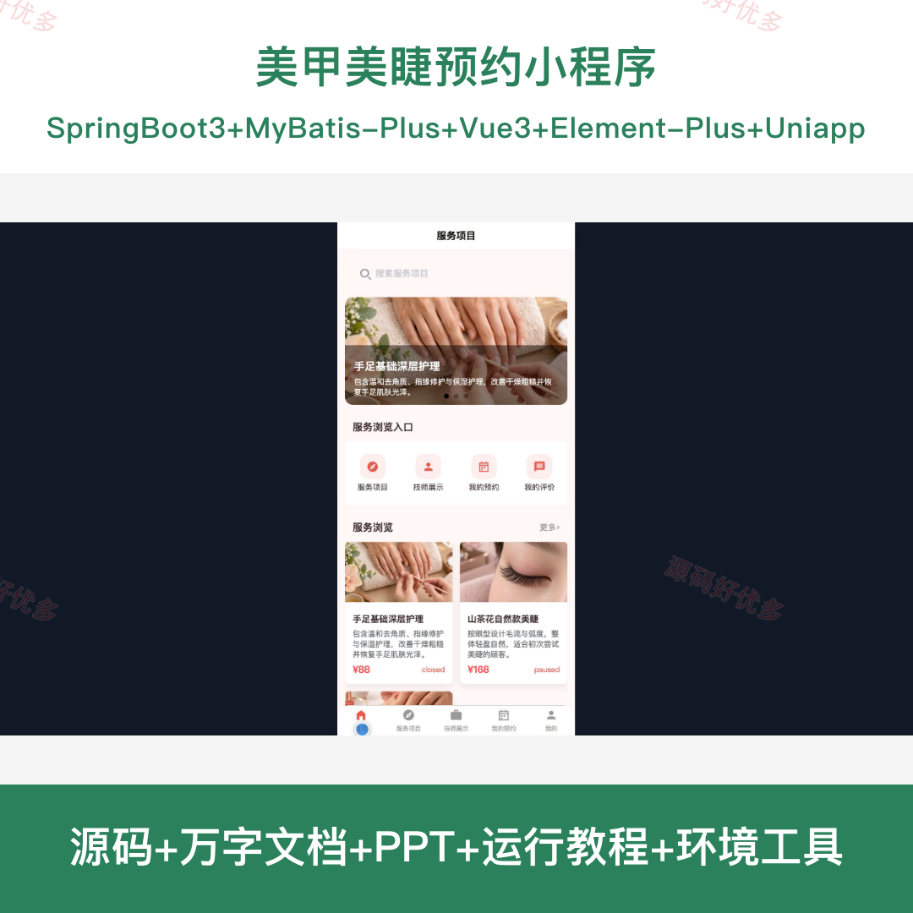
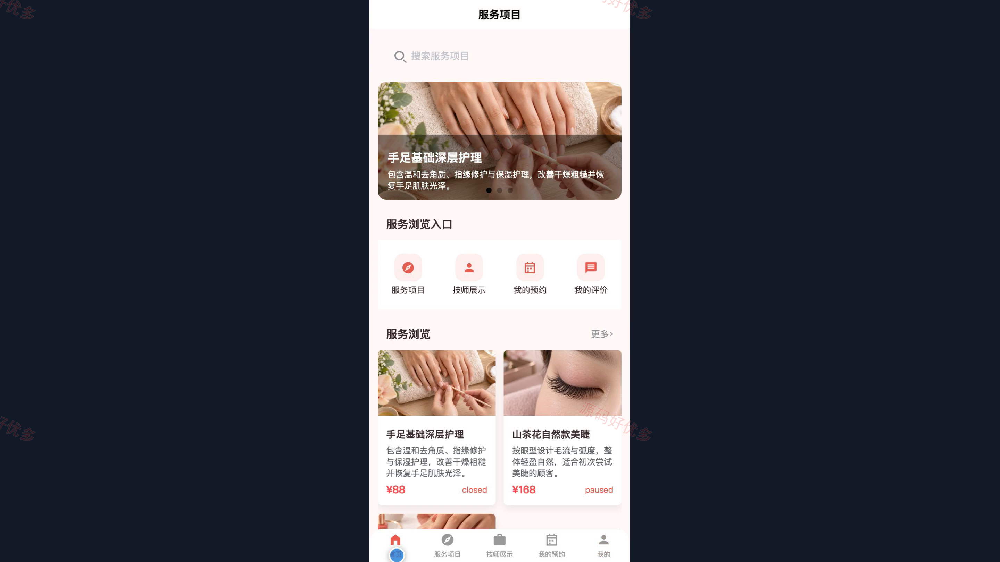
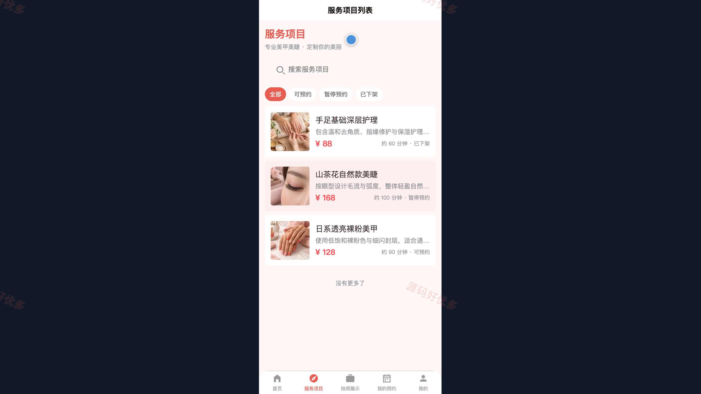
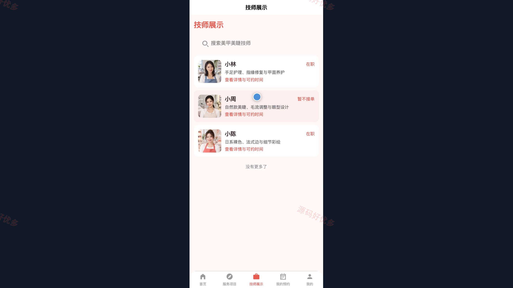
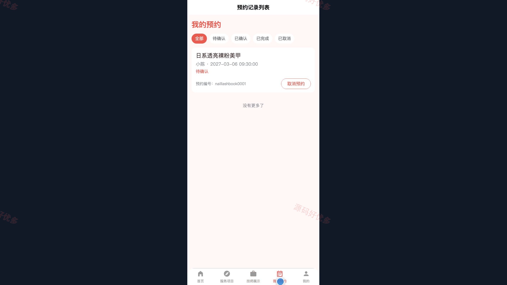
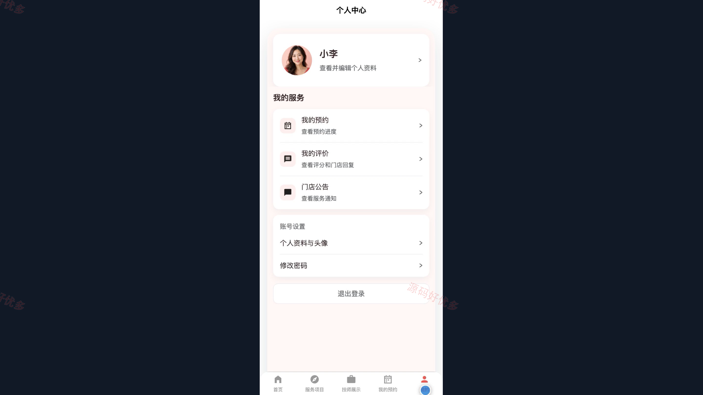
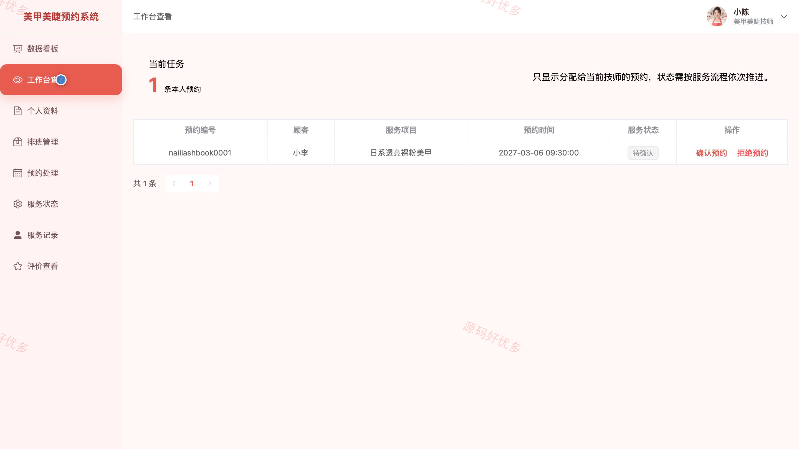
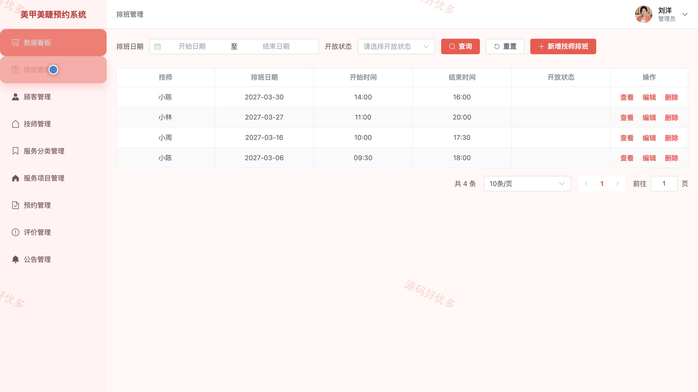
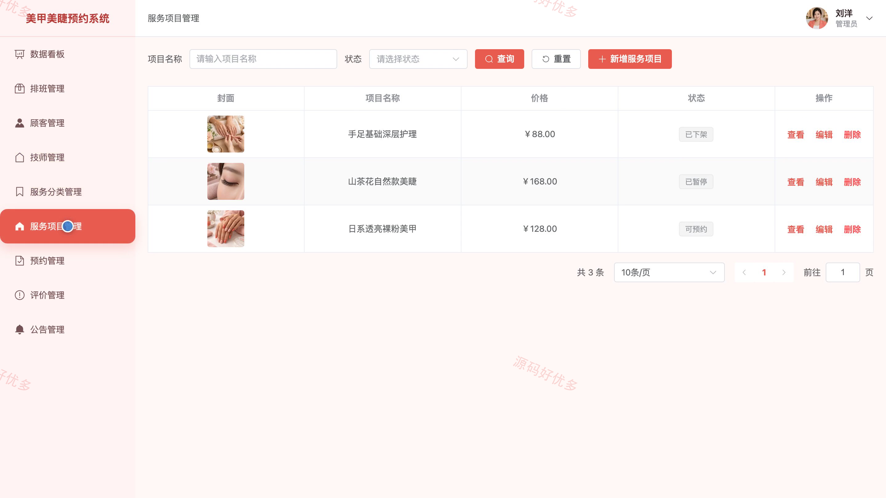

# bs140B
bs140B美甲美睫预约小程序源码 Java SpringBoot3 Vue3 前后分离
## 源码问题查看主页咨询

### 一、关键词
美甲美睫预约、美甲服务预订、美睫造型预约、技师档期、到店美容服务

### 二、作品包含
源码+数据库+万字设计文档+PPT+全套环境和工具资源+本地部署教程

### 三、项目技术
前端技术： Html、Css、Js、Vue3.4、Element-Plus、uniapp
后端技术：Java、SpringBoot3.2.0、MyBatis-Plus

### 四、运行环境要求
开发工具：IDEA/eclipse + VSCODE + HBuilder X + 微信开发者工具

数据库：MySQL5.7+（共12张表）

数据库管理工具：Navicat10以上版本

环境配置软件： JDK17 + Maven3.6

前端Nodejs：16+

浏览器：谷歌浏览器

### 五、项目介绍
项目编号：bs140B

美甲美睫预约小程序连接顾客、技师与门店管理员。顾客在小程序浏览服务和技师、选择时段预约并评价；技师在 PC 管理端处理预约、排班和服务进度；管理员维护人员、服务项目、评价与门店公告。

角色：顾客、美甲美睫技师、管理员

顾客功能：注册与登录、浏览美甲美睫服务、查看技师资料与作品、选择技师和时段预约、查看与取消预约、评价已完成服务、查看公告、维护个人资料与密码。

美甲美睫技师功能：查看预约工作台、维护个人资料与作品、管理可预约排班、确认或拒绝预约、更新服务进度、查询历史服务记录、查看顾客评价。

管理员功能：查看预约数据看板、管理顾客与技师、维护服务分类和项目、处理预约与异常、维护技师排班、管理顾客评价、发布门店公告、维护个人账号。

### 六、运行截图

